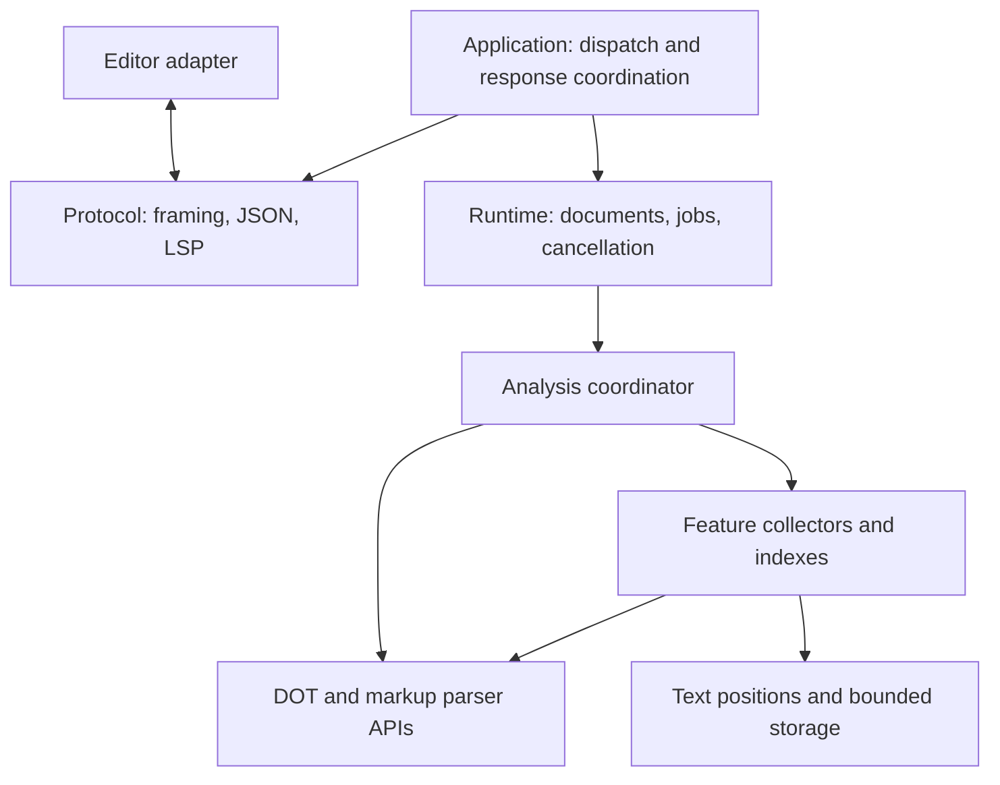

# dot-ls architecture

Status: migration steps 0–8 are implemented. The layout and ownership rules below
are current. Unit/protocol, allocator and performance checks cover the migration.
The current local packaged Zed smoke check passes: process metadata verifies the
managed server path, and the user confirms diagnostics, hover and quick-fix
application. The UI tool could not capture/control the separate test instance.
These checks do not complete the separate M0 platform and publication gates.

## Purpose

Provide a small native DOT language server with low startup cost, fast diagnostics
and bounded memory. Use dot-parser for DOT syntax and its markup subsystem for
HTML-like labels. Add editor features through compact, explicitly owned data.
Do not retain a full AST by default. An AST requires a demonstrated feature need,
a measured comparison and an explicit design decision.

The process communicates over stdio. It does not open a network port. Editors
start and stop the executable. Editor adapters stay outside the server binary.
There is one protocol thread and at most one analysis worker. The worker starts
with the first accepted document and sleeps on a condition when idle.

## Layers and dependency direction



Arrows from the application show code dependencies; the editor link shows wire
communication. Protocol and runtime do not import each other. The application
connects them. Parser and text code must not import the protocol or runtime. Feature code must not start threads, read files, write stdout or look up
editor settings. The runtime supplies source, allocators, cancellation and work
priority. The protocol translates client capabilities and wire values.

Keep concrete modules small enough to have one responsibility. Do not add a
plugin framework, generic service container or extra process for these layers.
A directory is useful when it groups several modules; an empty directory is not
an architecture boundary.

| Layer | Current modules | Responsibility |
| --- | --- | --- |
| Process entry | `src/main.zig` | Arguments, allocators and I/O setup; calls the application |
| Application | `src/app.zig` | Lifecycle dispatch, wire conversion, leased response views and the nonblocking protocol event loop |
| Runtime ownership | `src/runtime/server.zig`, `document.zig`, `job.zig`, `requests.zig`, `limits.zig`, `worker.zig`, `snapshot.zig` | One state facade, publication/query decisions, source/job ownership, pending IDs, worker priorities, reader leases, budgets and cleanup |
| Protocol | `src/protocol/framing.zig`, `src/protocol/lsp.zig`, `src/protocol/requests.zig`, `src/protocol/responses.zig`, `src/protocol/output.zig` | Framing, wire types/error codes, typed borrowed commands, bounded frame encoding and write progress |
| JSON intake | `src/protocol/json_message.zig` | Decode request metadata and text; make allocation ownership explicit |
| Analysis | `src/analysis/dot.zig`, `src/analysis/parser_policy.zig`, `src/analysis/validation.zig`, `src/analysis/pipeline.zig` | Coordinate phases, run public event sessions, apply the editor policy and collect typed findings |
| Finding model and presentation | `src/analysis/diagnostic_text.zig` | Source-independent findings and related notes; turn typed parser details into wording without reparsing |
| HTML labels | `src/features/labels.zig` | Select labels, check fragments, cache exact content and rebase results |
| Attribute help | `src/features/attributes.zig` | Static catalog suggestions, hover wording and compact owned key spans; no source retention |
| Completion | `src/features/completion_context.zig`, `src/features/completion.zig` | Store compact lexical regions and return valid keyword candidates |
| References | `src/features/references.zig` | Collect spans, intern logical node identities and store compact occurrences |
| Outline | `src/features/outline.zig` | Capture recovery-safe declarations and store hierarchy and ranges |
| Quick fixes | `src/features/code_actions.zig` | Store parser-provided edits and build versioned repair offers |
| Shared text | `src/text/types.zig`, `src/text/positions.zig`, `src/text/coordinates.zig` | Shared types, source-backed conversion and source-independent compact coordinates |
| Dependency | `vendor/dot-parser`, `vendor/upstream.json` | Unmodified pinned parser source, licenses and exact upstream hashes |

This table and the layout below describe existing files. Keep module boundaries
explicit when adding or moving code.
The current dependency uses public event sessions without local parser patches.
Outlines use statement starts/heads, delimiter observations and commit extents.
Trusted identifier operations use upstream APIs.
Parser-issued `dot.Name` values stay typed through reference construction,
duplicate-key checking and HTML-label selection. Convert to spans only for
locations. Bind logical readers with `identifier.fromName` while job source is
alive. The upstream graph layer, token previews and extra name observations
remain disabled; adding them requires a separate feature and memory decision.
Verify exact dependency bytes with `python3 tools/check_vendor.py`. Do not duplicate
parser grammar in the LSP layer. Lexical completion context is an editor approximation, not a
second authority for accepting DOT syntax.

## Ownership and lifetime

| Owner | Owned data | Lifetime |
| --- | --- | --- |
| Dispatcher | Input packet and decoded request metadata | One dispatch, unless packet ownership transfers to a job |
| Server | Document table, worker, counters and shared HTML budget | Process |
| Document | URI, generation, version, published lease handles, HTML cache and queued request IDs | Open document; derived handles are retired on edits |
| Snapshot lease | One immutable feature index or fix catalog, copied URI/version/generation and accounting | Until document ownership and all reply readers release it |
| Job | Immutable source allocation, copied URI, parser scratch/collectors, temporary findings and construction buffers | One analysis generation, including delayed phases |
| HTML cache entry | Exact fragment bytes and fragment-relative findings | Reference counted across documents/jobs until last owner releases it |
| Output queue | Owned JSON chunks, frame header, optional copied diagnostic URI/generation and write offsets | Until sent, superseded before starting, or connection teardown |

Borrowed byte spans are valid only while the job's source allocation lives.
Published completion, reference, outline and fix indexes must own all data needed
for requests. They must not retain a pointer into freed job source. The bounded
HTML cache is the explicit exception: it owns selected fragment bytes, not the
whole document.

Pass allocators explicitly. Keep fixed parser scratch separate from heap-owned
indexes. The current default uses the page allocator, with an explicit packed
allocator for small HTML entries. Arena allocation is suitable for a temporary
phase only when its lifetime is clear. Do not add allocator variants without a
measured benefit. Account for allocated capacity and growth overlap as well as
logical payload. Limits on published indexes do not bound every temporary buffer.

## Analysis and publication order

1. Accept an open/change event and assign a new server-wide generation.
2. Retire old derived state and queued requests. Cancel obsolete active work.
3. Decode/own the immutable source snapshot and queue its syntax job.
4. Parse outer DOT with the named policy, metering and cancellation. Collect
   findings, selected label spans, reference spans and outline declarations.
5. Publish current-generation DOT diagnostics and its available fix catalog.
6. Check HTML labels in delayed units. Reuse a cached result only after exact
   content comparison. Publish merged findings without losing DOT findings.
7. Build completion context. Convert the outline with the same coordinate data
   while the worker owns it. Publish those indexes and answer waiting requests.
8. Build reference identities and ranges, then answer waiting reference requests.
9. Release construction storage and the whole source snapshot.

This is the current order, not a promise that background work has zero cost.
Collectors must do little work during parsing. Move interning, decoding and range
conversion after diagnostic publication. Avoid new source scans when existing
coordinate data can serve the feature safely.

Syntax work has priority over delayed work. Use cooperative cancellation and
bounded polling intervals. Metering is a work bound, not a wall-clock latency
guarantee. Do not add debounce, adaptive credits or more workers without measuring
both responsiveness and peak memory. Completion/outline construction currently
restarts some work after a yield; HTML can reuse completed fragment work.

## Consistency, recovery and failures

Every result and queued request belongs to a document generation. Check generation,
URI and cancellation before publishing. Editor version numbers alone are not
sufficient because close/reopen can reuse them. Retire stale requests with
`ContentModified`; honor explicit request cancellation while queued.

Public parser events use statement commit/abort and can resume after safe error
recovery. Public node heads preserve provisional declarations, delimiter events
close recognized scopes during recovery, and commit extents give full ranges.
An undecided bare/ported prefix is kept only for an actual EOF diagnostic in
node-ending grammar. Do not
invent symbols from attribute tokens or skipped input. References currently
require a complete valid parse; outline and lexical completion have different
recovery contracts. Do not force all features to share one validity flag.

A feature allocation failure must not suppress otherwise available diagnostics.
Return an explicit unavailable/incomplete result when a limit prevents complete
coverage. Do not silently truncate an outline or claim all HTML was checked.
Keep parser-provided possible fixes distinct from machine-applicable fixes.

## Editor boundary

Zed grammar queries own syntax colors, brace pairing, pair matching, indentation
and current folding. The LSP owns diagnostics, keyword candidates, references,
outline symbols and quick fixes. These are separate costs and test surfaces.
Quoted `"<A></A>"` remains a string; `<<A></A>>` is HTML-like DOT content.
Use theme captures rather than fixed colors.

Presentation remains within the owning modules. Analysis formats plain diagnostic
text from typed facts. Attribute help formats static catalog content on demand
into a bounded buffer. Protocol negotiates hover Markdown/plaintext at initialize;
the application keeps that immutable connection preference. Runtime snapshots
and collectors do not store formatted hover cards. Quick-fix titles stay in the
feature module; no custom UI library or theme colors enter the server.

Release packaging stays outside the server in `tools/`. Native candidates use
isolated build prefixes and include licenses, dependency notices, version data
and archive checksums. The Zed adapter resolves explicit settings/PATH first,
then a versioned managed cache in its own work directory. A cold cache downloads
the exact pinned release into staging, validates native architecture and renames
only after success. Warm starts use no network. No worktree-relative server path
is inferred. Local profile staging never modifies normal editor data.

Keep adapters portable and their dependencies pinned. A local compiled grammar
replacement is an experiment until the adapter can build/distribute it through
its documented installation path. Do not claim that a local Zed memory result
is a property of the server or a shipped customer configuration.

## Repository and documentation rules

| Path | Contents |
| --- | --- |
| `src/` | Runtime and feature implementation; focused Zig unit tests may sit beside code |
| `tests/` | Protocol acceptance and real-editor smoke checks |
| `editors/` | Editor adapters, queries and adapter build sources in `editors/zed/`; grammar experiments in `editors/experiments/` |
| `examples/` | Intentional manual test files. Large fixtures are generated by `tools/make_large_examples.py` and are not in Git |
| `tools/` | Maintained development commands; no server runtime dependency |
| `docs/` | The small authoritative document set listed in `docs/README.md` |
| `bench/reports/` | Historical experiment reports, explicitly marked historical |
| `bench/results/` | Raw measurements, binary/source identities and environment records |
| `bench/history/` | Retired source-specific instrumentation and migration records |
| `vendor/` | Unmodified pinned dependency sources, licenses and hash manifest |
| `.github/workflows/` | CI checks, release archive builds, matching-host archive tests and draft releases |

Write no benchmark output, heap dump, machine log or session report into `docs/`.
Build caches, generated editor build output and runtime logs are not source.
Large requested examples are intentional fixtures and must not be removed as
junk. Git does not track them; the generator reproduces their exact bytes. Production builds and tests must not depend on historical reports, raw
measurements or any file outside this project.

## Folder and file layout

Keep the repository folders above. Reorganize only server source as shown here.
Keep existing protocol tests, examples, tools and editor adapters at their current
paths. These modules now exist. Do not create empty placeholder files or directories.

```text
src/
  main.zig                       # Process entry and command-line handling
  app.zig                        # Connect protocol, runtime and output
  protocol/
    framing.zig                  # Content-Length framing and packet limits
    json_message.zig             # Existing JSON intake and text ownership
    lsp.zig                      # Wire types, capabilities and error codes
    requests.zig                 # Decode and validate supported LSP methods
    responses.zig                # Diagnostics and feature response encoding
    output.zig                   # Owned outbound frames and write progress
  runtime/
    server.zig                   # State facade and synchronized transitions
    document.zig                 # Open-document state and invalidation
    job.zig                      # Source snapshot and analysis lifetime
    worker.zig                   # One worker, priorities, wakeup and shutdown
    requests.zig                 # Owned pending requests and cancellation
    snapshot.zig                 # Published feature data and safe read lifetime
    limits.zig                   # Process/document budgets and admission checks
  analysis/
    pipeline.zig                 # DOT, HTML and index phase coordination
    dot.zig                      # Existing analysis.zig parser/event runner
    parser_policy.zig            # Named dot-ls parser policy
    validation.zig               # Bounded checks from parser events
    diagnostic_text.zig          # Typed finding descriptions
  features/
    labels.zig                   # HTML selection, checking and exact-content cache
    attributes.zig               # Catalog metadata and compact hover keys
    completion_context.zig       # Lexical editing context, not shared coordinates
    completion.zig               # Keyword and attribute candidate selection
    references.zig               # Logical node identities and occurrences
    outline.zig                  # Recovery-safe declarations and hierarchy
    code_actions.zig             # Parser-provided fixes and generation tokens
  text/
    types.zig                    # Encoding, positions and ranges
    positions.zig                # Existing source-backed line conversion
    coordinates.zig              # Source-independent compact coordinate lookup
  tests.zig                      # Explicit unit-test import root
  tests/
    parser_sessions.zig          # Existing parser_session_tests.zig
```

Use ordinary Zig modules with explicit parameters. Do not add a service registry,
a plugin framework or one file per LSP method. Keep small related wire handlers
in `protocol/requests.zig` and `protocol/responses.zig`. Split them later only if
size and responsibilities justify it. Feature names remain recognizable during
the move. Update `build.zig` and local imports in the same step as each move.

### Responsibilities and ownership

| Module | Owns or does | Must not do |
| --- | --- | --- |
| `main.zig` | Read process arguments, select allocator/I/O, start and stop the application | Hold documents, implement LSP methods or run parser phases |
| `app.zig` | Route decoded commands to runtime operations; turn runtime results into wire replies; coordinate input/output progress | Own a second document table, duplicate generation checks or parse DOT |
| `protocol/framing.zig` | Read and validate headers, enforce wire-size limits, return owned packet bytes | Select document jobs or access feature indexes |
| `protocol/json_message.zig` | Own decoded JSON storage and expose the existing explicit source/packet transfer | Retain borrowed JSON fields after the message is released |
| `protocol/lsp.zig` | Wire-only structures, negotiated capabilities and LSP constants | Become the shared internal text or runtime model |
| `protocol/requests.zig` | Validate IDs, methods and parameters; expose typed commands with documented borrowed lifetimes | Mutate documents, queue jobs or hold the state mutex |
| `protocol/responses.zig` | Encode findings, completions, hover, references, symbols and fixes into LSP shapes | Read mutable runtime state or decide whether a generation is current |
| `protocol/output.zig` | Own complete outbound frame storage until sent; account for pending bytes; preserve frame boundaries | Hold runtime locks during encoding/writing or start another worker |
| `runtime/server.zig` | Own the document table, synchronization and aggregate counters; expose state operations and result acceptance | Decode JSON, format messages or write stdout |
| `runtime/document.zig` | Own URI, version, generation, caches and published snapshot handles; retire derived state on edits/close | Own worker threads or borrow a released job source |
| `runtime/job.zig` | Own immutable source/URI, cancellation flag and analysis construction state; release them once | Borrow a dispatcher packet without an explicit ownership transfer |
| `runtime/worker.zig` | Run one analysis worker; select jobs, handle priority/yield, wakeup and join | Own wire encoding, perform editor I/O or keep duplicate document state |
| `runtime/requests.zig` | Own pending request IDs/parameters and document generations; enforce queue limits and retire cancelled/stale requests | Keep borrowed `std.json.Value` strings or emit wire error replies |
| `runtime/snapshot.zig` | Own immutable published indexes/fixes and explicit reader leases; release storage after the final reader | Retain the source, build a full AST or use one success flag for all features |
| `runtime/limits.zig` | Name existing runtime budgets and perform checked admission/accounting | Replace feature-specific format limits or silently raise current caps |
| `analysis/pipeline.zig` | Own phase progression and temporary collector state within a job; yield typed phase results | Access documents, acquire server locks or publish to the editor |
| `analysis/dot.zig`, policy and validation | Run parser events, apply policy and collect bounded findings | Retain a full tree or duplicate parser grammar |
| `analysis/diagnostic_text.zig` | Convert typed parser findings into wording | Reparse source or encode full LSP replies |
| `features/*.zig` | Own each feature's collectors, compact data, limits and query operations | Import runtime/protocol, start threads or write responses directly |
| `text/*.zig` | Own shared coordinate formats and conversions | Import feature, runtime, protocol or application modules |
| `tests.zig`, `tests/parser_sessions.zig` | Import server modules for unit tests and check parser integration contracts | Add test-only imports or profiling to production startup |

`runtime/snapshot.zig` is a lifetime boundary, not a second copy of each index.
Keep each feature independently available or unavailable. A partial publication
must not copy already-published large arrays. Transfer existing allocations where
possible. Reader leases must charge their still-live storage, including indexes
retired by an edit. They must not pin the whole source. Measure any change in
allocation count, peak overlap and retained memory before adoption.

`text/positions.zig` uses the source during construction. `text/coordinates.zig`
now contains the reusable, source-independent coordinate data extracted from
completion context. Outline and completion can use that data without one feature
owning the other's text model. Attribute help may remain part of the completion
context lifecycle. It does not need a separate scan or published snapshot.

Feature modules return data and candidates. Move their existing LSP-specific
serializers to `protocol/responses.zig`. Wire field names and LSP symbol/item
numbers belong there. Plain descriptions and feature-specific query rules remain
with the feature. Shared positions/ranges come from `text/types.zig`, not from
quick fixes or another feature's private structures.

### Allowed dependencies

These are direct code imports. Wire communication does not imply a reverse import.

| Importer | May import |
| --- | --- |
| `main.zig` | `app.zig`, build options and standard library |
| `app.zig` | Protocol and runtime public operations, shared text types |
| `protocol/*` | Other protocol modules, feature query/data APIs, diagnostic wording, shared text modules |
| `runtime/*` | Other runtime modules, analysis pipeline, feature data/cache APIs, shared text modules |
| `analysis/pipeline.zig` | DOT runner/policy/validation, feature builders, shared text modules |
| Other analysis modules | Parser APIs, shared text modules; the DOT event runner may feed feature collectors |
| `features/*` | Parser APIs, shared text modules; completion may use attribute catalog/help APIs |
| `text/*` | Other text modules, parser location/encoding helpers if needed, standard library |
| Test modules | Modules under test and their declared dependencies |

Standard library use is allowed in every row. Vendor modules must not import
application source. Other cross-feature imports need an explicit decision here;
in particular, outline must not import completion and runtime must not obtain
shared range types through quick fixes. Keep imports acyclic within each folder.
`runtime/server.zig` coordinates worker operations; the worker must not import the
server type back. Pass explicit work state and completion handoffs instead.

The protocol/runtime boundary uses typed operations, owned inputs, phase results
and snapshot leases. It does not exchange raw JSON trees. Copy small request
metadata as needed. Preserve the current single source-ownership transfer during
JSON intake; this refactor must not reintroduce a full source copy.

### Output and synchronization boundary

The state mutex protects document lookup, generation transitions, accounting and
publication. Acquire a safe snapshot lease while holding that mutex, then release
it before building or writing a response. Returning a borrowed pointer after
unlocking is not sufficient. Jobs and retired snapshots must have one final
release path even when encoding, cancellation or output fails.

`protocol/output.zig` keeps owned frame chunks and bounded write progress.
Input and output progress are coordinated by the existing protocol thread;
keep at most one analysis worker. A slow stdout reader must not hold the state
mutex or force an unbounded output queue. Moving `send` into another file alone
does not meet this requirement.

Queue credits cover active encoders as well as queued frames. They do not replace
input, index, cache or pending-ID limits. Phase collectors and reference/fix
serialization scratch remain separately bounded by their existing limits. No
output cap is preallocated at startup.

The implemented transport uses Zig 0.17 POSIX `poll`, nonblocking stdin/stdout and a
nonblocking wake pipe. The existing protocol thread advances both streams; the
one analysis worker only encodes and queues frames. The transport is runtime-tested on macOS and cross-compiles for aarch64 Linux.
Linux runtime checks and other platforms remain release work.

Output has a 128 MiB JSON body cap, 144 MiB bulk allocation-credit cap and 256
bulk frame slots. Credits include active encoders and queued chunk capacities.
Each bulk frame reserves 256 KiB for frame/URI/chunk-list growth overlap. Control replies (initialization, shutdown, clears and overload errors)
have separate 512 KiB credits, 64 slots, a 64 KiB body cap and 16 KiB
metadata allowance. Storage is allocated on demand, not at these cap sizes.
JSON writes directly into owned 4 KiB/64 KiB chunks. It is never flattened or
copied into a second full JSON buffer. At most two encoders exist. Feature
serialization scratch remains bounded by existing location/fix limits.

The worker may wait for credits outside runtime locks. The dispatcher never
waits for output capacity: a request that cannot encode gets an explicit resource
error from the control reserve. Exhausting that reserve fails the connection.
An accepted reply is not silently evicted. Only obsolete, unstarted diagnostics
may be suppressed. Output advances by at most 64 KiB per loop turn; input reads
are bounded to 256 KiB per turn. Partial packets do not block output progress.
EOF/exit cancels worker waits and drains completed frames for at most two seconds;
a stopped reader then fails the connection, including any partial frame. Normal
shutdown keeps serving input and output until exit. No additional thread starts.

Never discard a reply silently to make room. Reject work before accepting it when
capacity is unavailable, or use an explicit protocol error while delivery remains
possible. Once a frame has been partly written, finish it or terminate the
connection; cancellation must not leave a broken frame on stdout. Recheck a
queued diagnostic's generation before starting its frame. Bytes already sent
cannot be recalled; later current-generation findings supersede them.

### Step 4 ownership interfaces

Runtime state uses its own request IDs and owned queues. The application converts
IDs at the protocol boundary; runtime modules must not import protocol types.
`analysis/diagnostic_text.zig` also defines source-independent finding/related-note
data. Jobs own those records and their wording arena. Protocol encodes borrowed
views without copying whole finding arrays. This keeps the data model below both
runtime and protocol without adding another feature dependency.

A prepared job borrows a transferable packet until setup and worker startup
succeed. Commit gives the job that allocation; an explicit update result tells
the application to release its packet handle. Preparation failure frees only
runtime-created allocations. The caller still owns a packet that was not accepted.

A small borrowed observer reports retired request IDs and neutral failure reasons
synchronously. It now collects owned response views under the state lock; it does
not encode or write there. Its ID view expires when the callback returns. The
application supplies publication callbacks and calls `runtime/worker.zig.start`.
Runtime owns the single thread handle and joins it during shutdown. Worker
callbacks and application publication acceptance remain named bridges for step 8.

## Migration order and verification

Each step is a separate reviewable change. Do not combine a source move with a
parser update, new editor feature, allocator experiment or scheduling change.
Keep the current binary and before/after evidence for changes affecting execution.

| Step | Change | Checks before the next step |
| --- | --- | --- |
| 0 | Capture current feature behavior, binary identity, diagnostics/readiness timing and server memory. Record known gaps. | Current Zig 0.17 build, unit tests, all eight protocol suites, layout/vendor checks; controlled 5/20/40 MB plain/HTML baseline |
| 1 | Extract shared encoding/position/range types into `text/`. Move source-backed positions and extract reusable coordinates without changing their format. | UTF-8/16/32, CR/LF/CRLF, malformed text and range boundaries; outline/completion/hover/fix parity; memory and scan-count comparison |
| 2 | Move existing analysis and feature modules to their target folders. Add `tests.zig` and move parser-session integration tests. Preserve collectors, phase order and storage. | Debug/safe unit tests, parser integration, all protocol suites, import/layout/vendor checks; compare timing and peak/settled memory |
| 3 | Extract framing, JSON intake, wire types, request decoding and response encoding into `protocol/`. Introduce `app.zig` to connect existing behavior. | Framing errors, packet limits, source transfer/failure cleanup, initialization and unsupported requests; exact feature behavior and diagnostic-order parity |
| 4 | Extract document/job/pending-request ownership and limits into `runtime/`. Keep one state facade and current locking/output behavior initially. | Stale edit/close/reopen, request cancellation, queue exhaustion, allocation failure and multiple documents; verify no second source copy or retained source |
| 5 | Extract `analysis/pipeline.zig` and `runtime/worker.zig`. Keep current priorities, yields and DOT → HTML → context/outline → references order. | Cancellation at phase boundaries, sustained edits, worker wakeup/join and shutdown; unchanged diagnostic publication order and measured responsiveness |
| 6 | Introduce explicit immutable snapshot leases. Move encoding outside the state mutex, preserving generation and fix-version checks. | Concurrent edit/close during replies, stale/cancelled requests, allocation/encoding failure, retired-index cleanup and charged memory overlap |
| 7 | Implement bounded output progress in `protocol/output.zig` after specifying its caps and I/O design above. | Slow/stopped stdout reader, large replies, partial writes, queue pressure, input/cancellation progress, broken pipe and shutdown; no silent reply loss |
| 8 | Remove temporary extraction bridges, audit imports/ownership and update the current-layout table. Leave `main.zig` with startup only. | Full unit/protocol checks, dependency/layout audit, Zed smoke check and final controlled 5/20/40 MB comparison; review remaining M0 release gates |

Steps 3–6 used temporary application publication and output-ticket bridges. Step 8
removes them. Current cross-layer callbacks are the typed `runtime.Events`
handoff: they borrow data under the state lock and retain readers/copy small
metadata. The application encodes after returning. They are the intended boundary,
not a protocol import into runtime.

Run `python3 tools/check_layout.py` after every layout/documentation change.
Update that checker when the source tree becomes nested so valid relative imports
remain checked against the complete `src/` boundary. Run `tools/check_vendor.py`
when parser integration changes; do not change vendor code for a file move.
Use the maintained measurement commands in [DEVELOPMENT.md](DEVELOPMENT.md).
Do not broaden tests without a relevant change, failure or unresolved concern.

The target is complete when responsibilities and imports match this document,
current features and limits remain covered, and measured memory/startup/diagnostic
costs are reviewed. File count or a shorter `main.zig` alone is not completion.
Packaging, supported platforms and the final release checklist remain separate
M0 work in [REQUIREMENTS.md](REQUIREMENTS.md).

### Migration status

Steps 0–8 are implemented. The checkpoints and measured binary identities are
linked in [PERFORMANCE.md](PERFORMANCE.md). Shared text, analysis, features,
protocol, runtime ownership and the worker now use the layout above. Main contains
startup only. The following describes the final boundaries.

Step 7 adds bounded owned frames, incremental packet intake and a nonblocking
POSIX event loop. Stdout is written only by the protocol thread. A wake pipe
notifies it when the existing analysis worker queues a frame. Parser/feature
phases keep their order. A worker can wait for output credits outside state
locks; close wakes it before join. The dispatcher reports output pressure from
the control reserve, and closes the connection if that reserve is exhausted.
Partial frames finish or the connection fails. Repeated reads do not spin on a
blocked writer. Ordinary error replies use bulk capacity so 64 retired pending
requests do not consume the shutdown reserve.

Step 8 moves publication admission, generation/fix-version checks, ready/pending
query selection, result failure and worker startup into `runtime/server.zig`.
The application imports only protocol/runtime/text modules and build options.
It no longer reads document tables, active jobs or accounting fields. Wire error
codes/messages and flat/hierarchical outline encoding remain above runtime.
The worker imports no server type. Production startup calls its public operation;
a private runtime startup seam keeps deterministic rollback tests.

`runtime.View` describes source-independent feature readers. `runtime.Events`
reports views, neutral failure reasons and phase notices. Its callbacks borrow
IDs/data synchronously under the state lock. Readers are retained before unlock.
DOT findings remain job-owned. The completed merged HTML result is also job-owned
until application encoding finishes; `releaseResult` and the job destructor share
one cleanup path. Its arrays are transferred, not copied. This prevents a local
phase temporary from being freed before an encoder uses it. Failure diagnostics
carry generation tags through the same final-frame check as normal diagnostics.

The application keeps at most two synchronous batches of small response views.
These use existing pending-request/ID bounds; frame credits count the encoded
storage separately. Feature readers release after encoding, while the output
queue owns independent bytes through delivery. No source/AST is pinned by a frame.
The layout checker now enforces application boundaries, mutable-state access
rules and an acyclic local import graph. Parser/vendor bytes and editor grammar
are unchanged. The compatibility executable alias remains for existing editors.

69 unit tests and ten protocol suites cover the final boundaries. In-place and
arena intake pass focused checks with the debug allocator. Tests include partial
headers/bodies, a paused/resumed reader, a large intact outline, queued cancellation
while stdout is paused, output pressure, worker wakeup on close, bounded exit,
broken pipe and allocation failures. Exact baseline feature replies still match.
The final Zed server-launch check succeeded; visual repair verification remains
unconfirmed because the UI tool returned mismatched windows/noWindowsAvailable.
No existing dirty editor buffer was saved or discarded.

## Review gate for future changes

State the owning layer, allocation lifetime, limits, cancellation behavior and
recovery behavior. Update existing requirements/features if behavior changes.
Run focused unit/protocol checks and compare diagnostics delay and memory for
changes that affect parsing, indexes or retained data. Record server and editor
costs separately. A new dependency or retained AST needs an explicit rationale.

Attribute completion and hover share the completion context lifecycle and bounded
request queue. The lexical pass records compact catalog IDs and byte spans after
DOT diagnostics. The feature module owns the data format and wording; protocol
code only translates requests and replies. Edits retire both features together.
